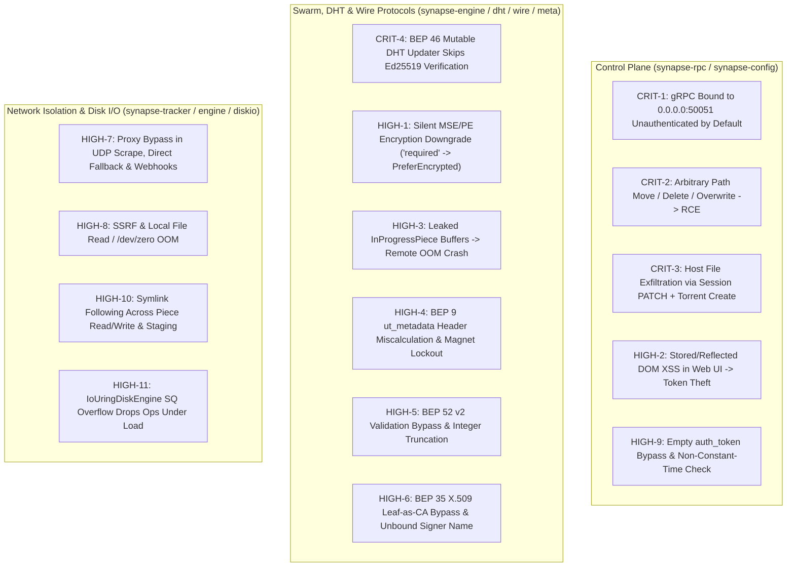

# Synapse 2.0 Security Audit & Hardening Report

This report documents the findings from a full-workspace security audit of the `synapse` BitTorrent client (`v2.2.22`, 14 Rust crates). While `synapse` already implements strong defensive primitives—such as zero-unsafe Rust across almost all crates, bounded bencode parsing, BEP 42 DHT Sybil defense, SSRF IP classifiers in `synapse-tracker`, and AES-256-GCM session encryption—several **Critical** and **High** severity vulnerabilities were identified across the RPC control plane, filesystem lifecycle, protocol state machines, and cryptographic verification paths.

---

## 1. Critical Severity Findings

> [!CAUTION]
> Critical findings allow remote unauthenticated or control-plane attackers to execute arbitrary code on the host, delete or exfiltrate arbitrary host files, or hijack remote torrent update feeds without valid cryptographic signatures.

### [CRIT-1] Unauthenticated-by-Default gRPC Control Plane on `0.0.0.0:50051` & Missing Handler-Level Auth

* **Locations:**
  * [`RpcConfig::default`](../crates/synapse-config/src/lib.rs#L725-L732)
  * [example_config.toml](../example_config.toml#L110-L115)
  * [`SynapseRpcService`](../crates/synapse-rpc/src/service.rs#L354-L1112)
* **Mechanics & Impact:**
  1. Despite [TRUST_AND_SAFETY.md](../docs/TRUST_AND_SAFETY.md#L208) and the comment in [example_config.toml](../example_config.toml#L111) stating that the gRPC server binds to `127.0.0.1:50051` by default, [`RpcConfig::default`](../crates/synapse-config/src/lib.rs#L725-L732) sets `enabled: true`, `listen_addr: "0.0.0.0:50051"`, and `auth_token: None`. Any host running with default settings exposes an unauthenticated gRPC control plane to the local network/internet.
  2. Inside [`SynapseRpcService`](../crates/synapse-rpc/src/service.rs#L354-L1112), only 8 newer handlers call [`self.verify_auth(&request)?`](../crates/synapse-rpc/src/service.rs#L64-L79). The remaining 15 RPCs—including [`add_torrent`](../crates/synapse-rpc/src/service.rs#L354-L410), [`remove_torrent`](../crates/synapse-rpc/src/service.rs#L412-L429), [`set_location`](../crates/synapse-rpc/src/service.rs#L1031-L1052), [`set_rate_limits`](../crates/synapse-rpc/src/service.rs#L971-L984), and all 4 `subscribe_*` streams—omit `self.verify_auth(&request)?` and rely exclusively on the outer Tonic interceptor in [main.rs](../crates/synapse-daemon/src/main.rs#L964-L981).
* **Remediation:**
  * Change [`RpcConfig::default`](../crates/synapse-config/src/lib.rs#L725-L732) and [example_config.toml](../example_config.toml#L112) to bind to `"127.0.0.1:50051"`.
  * Refuse to start (or auto-generate a random ephemeral token) if `listen_addr` or `web.bind` is non-loopback and `auth_token` is `None`.
  * Enforce `self.verify_auth(&request)?` uniformly in all 23 gRPC handlers in [service.rs](../crates/synapse-rpc/src/service.rs).

---

### [CRIT-2] Arbitrary File Move, Overwrite, and Recursive Deletion via Unvalidated `download_dir`, `set_location`, `delete_torrent`, and `InstructionsWebhookPlugin` (Leads to RCE)

* **Locations:**
  * [`delete_torrent_handler`](../crates/synapse-rpc/src/http_api.rs#L1011-L1027)
  * [`Info::from_magnet`](../crates/synapse-meta/src/lib.rs#L727-L742)
  * [`Torrent::handle_set_location`](../crates/synapse-engine/src/torrent.rs#L3038-L3084)
  * [`add_torrent_handler`](../crates/synapse-rpc/src/http_api.rs#L851-L855), [`upload_torrent_handler`](../crates/synapse-rpc/src/http_api.rs#L1222-L1226), [`set_location_handler`](../crates/synapse-rpc/src/http_api.rs#L1276-L1296), and [`SynapseRpcService::set_location`](../crates/synapse-rpc/src/service.rs#L1031-L1052)
  * [`InstructionsWebhookPlugin::place_files`](../crates/synapse-engine/src/instructions.rs#L190-L250)
  * [Dockerfile](../Dockerfile#L26-L28) & [docker-entrypoint.sh](../docker-entrypoint.sh#L87-L89)
* **Mechanics & Impact:**
  1. **Arbitrary Directory/File Deletion:** Neither `download_dir` on torrent addition nor `dn=` in [`Info::from_magnet`](../crates/synapse-meta/src/lib.rs#L727-L742) is sanitized against `..` or absolute paths. Calling `DELETE /api/v1/torrents/:id?delete_data=true` in [`delete_torrent_handler`](../crates/synapse-rpc/src/http_api.rs#L1011-L1027) joins `stats.download_dir` with `stats.name` and immediately executes `std::fs::remove_dir_all(&path)` or `std::fs::remove_file(&path)`—even for a magnet link that never downloaded metadata or pieces.
  2. **Unverified File Move/Overwrite:** [`Torrent::handle_set_location`](../crates/synapse-engine/src/torrent.rs#L3038-L3084) iterates over `self.info.files`, checks `tokio::fs::try_exists(&src)` where `src = self.download_dir.join(&file.path)`, and renames/copies `src` to `new_dir.join(&file.path)` **even when 0 pieces have been downloaded or hash-verified**. A crafted `.torrent` added with `download_dir` pointing to an existing directory can move or overwrite any file writable by the daemon user.
  3. **Untrusted Webhook Target Path:** [`InstructionsWebhookPlugin::place_files`](../crates/synapse-engine/src/instructions.rs#L190-L250) blindly accepts `resp.target_dir` from the remote classification endpoint without verifying containment inside the base download root.
  4. **Privilege Escalation to RCE:** In [Dockerfile](../Dockerfile#L26-L28) and [docker-entrypoint.sh](../docker-entrypoint.sh#L87-L89), `/etc/synapse` is `chown`-ed to the runtime `synapse` user (`$PUID:$PGID`), where `synapse.toml` and `post_script = "/etc/synapse/on-complete.sh"` reside. Overwriting `/etc/synapse/on-complete.sh` or `/etc/synapse/synapse.toml` yields immediate command execution via [`PostScriptPlugin::on_event`](../crates/synapse-engine/src/lifecycle.rs#L296-L315).
* **Remediation:**
  * Sanitize magnet `dn=` names in [`Info::from_magnet`](../crates/synapse-meta/src/lib.rs#L727-L742) using the same path component checks as `.torrent` metadata.
  * Enforce canonicalized path containment under the configured base `download_dir` for all `download_dir` overrides, `set_location` calls, and `InstructionsWebhookPlugin` target directories.
  * In [`delete_torrent_handler`](../crates/synapse-rpc/src/http_api.rs#L1011-L1027), delete only tracked torrent files verified to reside within the canonical `download_dir` rather than calling `remove_dir_all(download_dir.join(name))`.
  * In [`Torrent::handle_set_location`](../crates/synapse-engine/src/torrent.rs#L3038-L3084), only move files that the torrent has actually created/allocated.
  * Remove `/etc/synapse` and `/usr/share/synapse` from `chown -R "$PUID:$PGID"` in [Dockerfile](../Dockerfile#L28) and [docker-entrypoint.sh](../docker-entrypoint.sh#L87-L89) so configuration and scripts remain root-owned (`0644`/`0755`).

---

### [CRIT-3] Arbitrary Host File Exfiltration via `PATCH /api/v1/session` + `POST /api/v1/torrents/create`

* **Locations:**
  * [`patch_session_handler`](../crates/synapse-rpc/src/http_api.rs#L480-L489)
  * [`SwarmEngine::apply_dynamic_settings`](../crates/synapse-engine/src/swarm.rs#L2513-L2515)
  * [`create_torrent_handler`](../crates/synapse-rpc/src/http_api.rs#L706-L788)
* **Mechanics & Impact:**
  * [`create_torrent_handler`](../crates/synapse-rpc/src/http_api.rs#L731-L748) checks that `req.path` is contained within `state.engine.settings().read().download_dir`. However, [`patch_session_handler`](../crates/synapse-rpc/src/http_api.rs#L480-L489) allows updating `download_dir` at runtime to any path on the filesystem (e.g., `/var/lib/synapse/session` or `/etc`).
  * An attacker with API access (or via CSRF/XSS) can `PATCH /api/v1/session` to set `download_dir` to `/var/lib/synapse/session`, call `POST /api/v1/torrents/create` on `session.key` or `session.db`, add the returned `torrent_base64` with `download_dir: "/var/lib/synapse/session"`, and download the host's sensitive files over the BitTorrent wire protocol.
  * Additionally, [`create_torrent_handler`](../crates/synapse-rpc/src/http_api.rs#L734-L741) calls `std::fs::canonicalize(&req.path)` *before* checking `target.starts_with(&base)`, creating a `404 Not Found` vs `403 Forbidden` oracle for probing the existence of arbitrary paths on the host.
* **Remediation:**
  * Anchor path containment checks to an immutable root directory configured at daemon startup (not the runtime-mutable `DynamicSessionSettings::download_dir`), and restrict `PATCH /api/v1/session` so `download_dir` can only be set to subdirectories of that immutable root.
  * Resolve relative paths against `base` and reject `..` components lexically before calling `canonicalize`.

---

### [CRIT-4] BEP 46 `TorrentUpdatePointer::poll_node` & `DhtHandle::get` Skip Ed25519 Signature Verification

* **Locations:**
  * [`TorrentUpdatePointer::poll_node`](../crates/synapse-dht/src/updater.rs#L77-L90)
  * [`DhtNode::get_item`](../crates/synapse-dht/src/node.rs#L461-L474)
* **Mechanics & Impact:**
  * While [`DhtStorage::put_mutable`](../crates/synapse-dht/src/storage.rs#L147-L153) verifies Ed25519 signatures when storing incoming `put` queries locally, [`TorrentUpdatePointer::poll_node`](../crates/synapse-dht/src/updater.rs#L77-L90) and [`DhtNode::get_item`](../crates/synapse-dht/src/node.rs#L461-L474) **never verify `item.sig` or check that `item.k == Some(self.public_key)`** when receiving a `get` response from a remote DHT node.
  * Any queried DHT node can reply with an unsigned or forged `item.v` and `seq = u64::MAX`, allowing trivial remote hijacking of BEP 46 mutable torrent feeds and permanently locking out legitimate updates (`seq <= current` is ignored thereafter).
* **Remediation:**
  * In both [`DhtNode::get_item`](../crates/synapse-dht/src/node.rs#L461-L474) and [`TorrentUpdatePointer::poll_node`](../crates/synapse-dht/src/updater.rs#L77-L90), verify that `item.k` matches the expected 32-byte Ed25519 public key (and that `SHA1(k || salt) == target`) and verify `item.sig` over [`format_sign_payload(salt, seq, &item.v)`](../crates/synapse-dht/src/storage.rs#L82-L91) using [`verify_ed25519`](../crates/synapse-dht/src/storage.rs#L94-L103) before accepting the payload or advancing `last_seq`.

---

## 2. High Severity Findings

### [HIGH-1] Silent Forced-Encryption Downgrade (`"required"` vs `"require_encrypted"`)

* **Locations:**
  * [`EncryptionMode::from_str_opt`](../crates/synapse-wire/src/crypto.rs#L16-L23)
  * [web.rs](../crates/synapse-rpc/src/web.rs#L447-L451)
  * [TRUST_AND_SAFETY.md](../docs/TRUST_AND_SAFETY.md#L154)
* **Mechanics & Impact:**
  * [`EncryptionMode::from_str_opt`](../crates/synapse-wire/src/crypto.rs#L16-L23) only maps `"require_encrypted" | "forced"` to `EncryptionMode::ForcedEncrypted`, falling back to `_ => EncryptionMode::PreferEncrypted` for all other strings.
  * However, the Web UI settings dropdown ([web.rs](../crates/synapse-rpc/src/web.rs#L450)) sends `<option value="required">Required (Encrypted Only)</option>`, and [TRUST_AND_SAFETY.md](../docs/TRUST_AND_SAFETY.md#L154) instructs users to set `encryption = "required"`. Users who select "Required (Encrypted Only)" in the Web UI or follow the documentation silently downgrade to `PreferEncrypted`, allowing plaintext BitTorrent handshakes!
* **Remediation:**
  * Accept `"required"` and `"strict"` as aliases for `EncryptionMode::ForcedEncrypted` in [`EncryptionMode::from_str_opt`](../crates/synapse-wire/src/crypto.rs#L16-L23) and [`validate_config`](../crates/synapse-config/src/lib.rs#L971-L977), and fail validation on unknown encryption strings instead of silently defaulting to `PreferEncrypted`.

---

### [HIGH-2] Stored & Reflected DOM XSS in Web UI (`web.rs`) Leading to Bearer Token Theft

* **Locations:**
  * [web.rs (torrent list rendering)](../crates/synapse-rpc/src/web.rs#L1229)
  * [web.rs (tracker status rendering)](../crates/synapse-rpc/src/web.rs#L1373)
  * [web.rs (file list rendering)](../crates/synapse-rpc/src/web.rs#L1407)
  * [`escapeHtml`](../crates/synapse-rpc/src/web.rs#L1751-L1754)
* **Mechanics & Impact:**
  * While cell text uses `escapeHtml(...)`, the `title` attributes in `<td title="${t.name}">` ([line 1229](../crates/synapse-rpc/src/web.rs#L1229)) and `<td title="${f.path}">` ([line 1407](../crates/synapse-rpc/src/web.rs#L1407)) and the tracker status cell `<td>${tr.status || 'Active'}</td>` ([line 1373](../crates/synapse-rpc/src/web.rs#L1373)) interpolate untrusted strings directly into `innerHTML`.
  * Because [`validate_layout`](../crates/synapse-meta/src/lib.rs#L1127-L1191) permits `"`, `<`, and `>` in torrent names and file paths, any `.torrent`, magnet link (`dn=`), RSS feed item, or tracker `failure reason` containing `"` breaks out of the attribute and executes arbitrary JavaScript in the user's browser, stealing `localStorage.getItem('synapse_auth_token')` ([line 1098](../crates/synapse-rpc/src/web.rs#L1098)) and driving the REST API.
* **Remediation:**
  * Wrap `t.name`, `f.path`, and `tr.status` in `escapeHtml(...)`, add `.replace(/'/g, '&#39;')` to [`escapeHtml`](../crates/synapse-rpc/src/web.rs#L1751-L1754), and add a strict `Content-Security-Policy` header to the embedded web server.

---

### [HIGH-3] Remote OOM Denial-of-Service via Leaked `InProgressPiece` Buffers in `Torrent::in_progress`

* **Locations:**
  * [`InProgressPiece::new`](../crates/synapse-engine/src/torrent.rs#L367-L374)
  * [`Torrent::try_request_more`](../crates/synapse-engine/src/torrent.rs#L2647-L2649)
  * [`Torrent::handle_peer_choked` / `handle_peer_disconnected` / `tick`](../crates/synapse-engine/src/torrent.rs#L1051-L1077)
* **Mechanics & Impact:**
  * [`Torrent::try_request_more`](../crates/synapse-engine/src/torrent.rs#L2647-L2649) allocates `InProgressPiece::new(piece_len)` (`vec![0u8; piece_len]`, up to 128 MiB per piece) immediately when a piece is picked—before a single byte of piece data is received.
  * When a peer chokes, disconnects, or times out without sending blocks, the cleanup paths ([lines 1051-1077](../crates/synapse-engine/src/torrent.rs#L1051-L1077), [line 1549](../crates/synapse-engine/src/torrent.rs#L1549), [line 1589](../crates/synapse-engine/src/torrent.rs#L1589)) call `self.picker.mark_missing(idx)` if `received == 0`, **but fail to remove `idx` from `self.in_progress`**.
  * A single malicious peer cycling `Have -> Unchoke -> Choke` without transmitting any block payload forces the client to allocate and retain `vec![0u8; piece_len]` for every piece in the torrent simultaneously, crashing the daemon via OOM.
* **Remediation:**
  * Remove `idx` from `self.in_progress` whenever `received == 0` on choke/disconnect/timeout, allocate the `InProgressPiece` buffer lazily upon receipt of the first `Piece` block rather than at request time, and cap the maximum total bytes or count of concurrent `in_progress` pieces.

---

### [HIGH-4] BEP 9 `ut_metadata` Header Miscalculation, Negative Integer Casts, & Permanent Magnet Lockout DoS

* **Locations:**
  * [`UtMetadataMessage::decode`](../crates/synapse-wire/src/extension.rs#L214-L266)
  * [`MetadataFetcher::on_handshake` & `on_data`](../crates/synapse-engine/src/metadata.rs#L52-L60)
* **Mechanics & Impact:**
  1. [`UtMetadataMessage::decode`](../crates/synapse-wire/src/extension.rs#L214-L266) casts `piece` and `total_size` from `i64` directly `as u32` without checking `< 0` (`-1` wraps to `u32::MAX`) and computes the offset of the raw metadata slice by encoding a synthetic 3-key bencode dictionary (`d8:msg_type...e`) and taking its `.len()`. If a peer includes any additional dictionary key (permitted by BEP 9) or negative integers, `header_len` is miscalculated and corrupts the metadata slice.
  2. In [`MetadataFetcher::on_handshake`](../crates/synapse-engine/src/metadata.rs#L52-L60), the very first peer to report a `metadata_size` permanently locks `self.total_size` (`if self.total_size.is_none()`). A single malicious peer reporting `metadata_size = 30_000_000` (above [`MAX_METADATA_SIZE`](../crates/synapse-engine/src/metadata.rs#L15)) permanently disables metadata fetching for that magnet link for the lifetime of the torrent.
  3. In [`MetadataFetcher::on_data`](../crates/synapse-engine/src/metadata.rs#L108-L120), a single bad chunk on the final piece causes `SHA-1` mismatch and calls `self.reset()`, discarding all pieces downloaded from honest peers.
* **Remediation:**
  * Return the exact byte offset consumed by `synapse_bencode::decode_first` instead of re-encoding a synthetic dictionary, and reject negative `msg_type`, `piece`, or `total_size` values in [`UtMetadataMessage::decode`](../crates/synapse-wire/src/extension.rs#L214-L266).
  * Validate `size > 0 && size <= MAX_METADATA_SIZE` *before* setting `self.total_size` in [`MetadataFetcher::on_handshake`](../crates/synapse-engine/src/metadata.rs#L52-L60), and track per-peer or majority-voted `metadata_size` so one peer cannot poison magnet resolution.

---

### [HIGH-5] BEP 52 v2 Metadata Validation Bypass, Negative Length Wrap (`-1 as u64`), & `u32` Piece Count Truncation

* **Locations:**
  * [`v2::parse_file_tree` & `walk_tree`](../crates/synapse-meta/src/v2.rs#L26-L73)
  * [`parse_info_dict` & `validate_layout`](../crates/synapse-meta/src/lib.rs#L802-L865)
* **Mechanics & Impact:**
  1. In [`v2::walk_tree`](../crates/synapse-meta/src/v2.rs#L42-L54), file `length` (`i64`) is cast directly `as u64` without checking `< 0` (`-1` wraps to `18446744073709551615`), and total length is accumulated with `.map(|f| f.length).sum()`, which panics on overflow in debug builds or wraps in release builds.
  2. In [`parse_info_dict`](../crates/synapse-meta/src/lib.rs#L802-L865), pure v2 torrents return early before calling [`validate_layout`](../crates/synapse-meta/src/lib.rs#L1127-L1191), completely bypassing `MAX_FILES` (`100_000`), `MAX_PATH_COMPONENTS` (`32`), `DuplicatePath` checks, and non-empty `info.name` validation (`name` defaults to `""` when missing).
  3. [`v2::walk_tree`](../crates/synapse-meta/src/v2.rs#L57) converts path segments via `String::from_utf8_lossy`, causing distinct invalid UTF-8 keys in the bencode dict to silently collide onto `\u{FFFD}` and overwrite the same file on disk.
  4. In [`parse_info_dict`](../crates/synapse-meta/src/lib.rs#L834-L838), `let count = (tlen.div_ceil(plen)) as u32;` truncates to `u32` *before* checking `if (count as u64) > MAX_PIECES` (`2_000_000`). A v2 torrent with `tlen / plen = 2^32 + 1` wraps `count` to `1`, bypassing `MAX_PIECES`.
* **Remediation:**
  * Reject negative `length` values and use `checked_add` when summing v2 file lengths in [`v2::walk_tree`](../crates/synapse-meta/src/v2.rs#L26-L73).
  * Require valid UTF-8 (`std::str::from_utf8`) for v2 file tree path segments.
  * Check `tlen.div_ceil(plen) > MAX_PIECES` as `u64` before casting to `u32`, and run [`validate_layout`](../crates/synapse-meta/src/lib.rs#L1127-L1191) on all v1, hybrid, and pure-v2 torrents.

---

### [HIGH-6] BEP 35 X.509 Chain Validation Bypass (Leaf-as-CA) & Unbound Signer Name

* **Locations:**
  * [`ParsedCert::issued_by`](../crates/synapse-meta/src/signature.rs#L260-L298)
  * [`TorrentSignature::verify`](../crates/synapse-meta/src/signature.rs#L319-L349)
* **Mechanics & Impact:**
  * [`ParsedCert::issued_by`](../crates/synapse-meta/src/signature.rs#L260-L298) checks only that `self.issuer == issuer.subject`, `issuer.is_Time_valid(now)`, and the RSA signature over `tbs_certificate` is valid. It never parses X.509 `BasicConstraints` (`cA == true`) or `KeyUsage` (`keyCertSign`). If a user places a trusted peer's end-entity leaf certificate in [`TrustStore`](../crates/synapse-meta/src/signature.rs#L65-L96), that leaf holder can act as a Certificate Authority and mint arbitrary subordinate certificates (`certificate` field in BEP 35).
  * Furthermore, [`TorrentSignature::verify`](../crates/synapse-meta/src/signature.rs#L319-L349) returns `SignatureStatus::Trusted { signer: self.name.clone() }` without verifying that the dictionary key `self.name` matches the signing certificate's Subject DN / Common Name, and [`rsa_verify`](../crates/synapse-meta/src/signature.rs#L249) still accepts `OID_SHA1_WITH_RSA`.
* **Remediation:**
  * When verifying a chained certificate (`self.certificate.is_some()`), require the issuer certificate in `TrustStore` to have `BasicConstraints(cA = true)` and `KeyUsage::keyCertSign`, bind `self.name` to the certificate's Subject CN/SAN, and remove `OID_SHA1_WITH_RSA`.

---

### [HIGH-7] Multiple Proxy Bypass & Real-IP / DNS Leak Vectors (`announcer.rs`, `proxy.rs`, `instructions.rs`)

* **Locations:**
  * [`Announcer::scrape`](../crates/synapse-engine/src/announcer.rs#L196-L217)
  * [`ProxyConfig::connect_peer` & `tracker_proxy_url`](../crates/synapse-engine/src/proxy.rs#L80-L112)
  * [`InstructionsWebhookPlugin::classify`](../crates/synapse-engine/src/instructions.rs#L119-L122)
* **Mechanics & Impact:**
  1. Unlike [`Announcer::announce`](../crates/synapse-engine/src/announcer.rs#L116-L137), [`Announcer::scrape`](../crates/synapse-engine/src/announcer.rs#L196-L217) does not check `crate::proxy::global()` for `"udp"` trackers. Scraping a torrent with a `udp://` tracker performs a direct system DNS lookup and sends UDP packets directly from the host's real IP even when `force_proxy = true`.
  2. In [`ProxyConfig::connect_peer`](../crates/synapse-engine/src/proxy.rs#L80-L86) and [`ProxyConfig::tracker_proxy_url`](../crates/synapse-engine/src/proxy.rs#L104-L112), if `force_proxy = true` is set alongside `proxy_peer_connections = false` or `proxy_tracker_connections = false`, connections silently fall back to direct `TcpStream::connect` instead of failing closed.
  3. [`InstructionsWebhookPlugin::classify`](../crates/synapse-engine/src/instructions.rs#L119-L122) constructs a raw `reqwest::Client::builder()` that ignores the global proxy configuration.
* **Remediation:**
  * Apply the exact same `proxy::global()` UDP check in [`Announcer::scrape`](../crates/synapse-engine/src/announcer.rs#L196-L217) as in `Announcer::announce`.
  * Fail closed in [`ProxyConfig`](../crates/synapse-engine/src/proxy.rs#L80-L112) whenever `force_proxy = true` is enabled.

---

### [HIGH-8] SSRF & Local File Read / `/dev/zero` OOM in `safe_http.rs`, `search.rs`, `url_fetcher.rs`, `feed.rs`, and Peer Discovery

* **Locations:**
  * [`safe_http::validate_and_resolve` & `is_public_ip`](../crates/synapse-tracker/src/safe_http.rs#L53-L88) ([lines 155-162](../crates/synapse-tracker/src/safe_http.rs#L155-L162), [199-215](../crates/synapse-tracker/src/safe_http.rs#L199-L215))
  * [`SearchManager::add_source` & `search`](../crates/synapse-engine/src/search.rs#L21-L66)
  * [`fetch_or_parse_torrent`](../crates/synapse-rpc/src/url_fetcher.rs#L69-L120)
  * [`FeedManager::fetch_and_parse_feed`](../crates/synapse-engine/src/feed.rs#L236-L242)
  * [`Torrent::handle_holepunch`](../crates/synapse-engine/src/torrent.rs#L3133-L3138) & [`run_announce_loop`](../crates/synapse-engine/src/announcer.rs#L1151-L1161)
* **Mechanics & Impact:**
  1. **Proxy + Hostname SSRF Bypass in `safe_http`:** In [`validate_and_resolve`](../crates/synapse-tracker/src/safe_http.rs#L155-L162), when `proxy_url.is_some()` and the URL host is a domain name, `addrs` is set to `Vec::new()`. Subsequently, `addrs.iter().all(|a| is_public_ip(a.ip()))` ([line 201](../crates/synapse-tracker/src/safe_http.rs#L201)) evaluates vacuously to `true` on an empty vector! Any hostname (`localhost`, `metadata.google.internal`, `127.0.0.1.nip.io`) bypasses `LocalPolicy::Deny` when a proxy is configured. Moreover, [`is_public_ip`](../crates/synapse-tracker/src/safe_http.rs#L53-L88) does not filter NAT64 (`64:ff9b::/96`, `64:ff9b:1::/48`) or IPv4-compatible (`::/96`) IPv6 addresses.
  2. **Unbounded File Read OOM & Full-Read SSRF in `SearchManager`:** [`SearchManager::add_source`](../crates/synapse-engine/src/search.rs#L21-L29) calls `tokio::fs::read(source)` *before* checking `bytes.len() > MAX_DESCRIPTION_BYTES`; passing `source = "/dev/zero"` via `AddSearchSource` causes an immediate OOM crash. In addition, [`SearchManager::search`](../crates/synapse-engine/src/search.rs#L58-L66), [`fetch_or_parse_torrent`](../crates/synapse-rpc/src/url_fetcher.rs#L120), and [`FeedManager::fetch_and_parse_feed`](../crates/synapse-engine/src/feed.rs#L236-L242) hardcode `LocalPolicy::AllowAny`, allowing callers (or remote `.btsearch` templates) to fetch internal loopback/link-local HTTP services and return titles/snippets to the API.
  3. **Internal Dialing via BEP 55 Holepunch & Tracker Peers:** [`Torrent::handle_holepunch`](../crates/synapse-engine/src/torrent.rs#L3133-L3138) (`HolepunchType::Connect`) and [`run_announce_loop`](../crates/synapse-engine/src/announcer.rs#L1151-L1161) dial peer addresses directly without checking [`pex::pex_address_allowed`](../crates/synapse-engine/src/pex.rs#L155-L176).
* **Remediation:**
  * Reject `localhost`, `.local`, `.internal`, and single-label hostnames even when `proxy_url.is_some()`, and only skip local DNS resolution when the proxy scheme actually delegates DNS (`socks5h://` or `http(s)://`). Block `64:ff9b::/96`, `64:ff9b:1::/48`, and `::/96` in [`is_public_ip`](../crates/synapse-tracker/src/safe_http.rs#L53-L88).
  * Remove the local filesystem read fallback from [`SearchManager::add_source`](../crates/synapse-engine/src/search.rs#L21-L29) and [`fetch_or_parse_torrent`](../crates/synapse-rpc/src/url_fetcher.rs#L69-L91) (or gate behind explicit local-only CLI flags and check `metadata.is_file()` + `metadata.len()` before reading), and default `search.rs`, `feed.rs`, and `url_fetcher.rs` to `LocalPolicy::Deny`.
  * Filter tracker, DHT, and BEP 55 holepunch peer addresses through [`pex::pex_address_allowed`](../crates/synapse-engine/src/pex.rs#L155-L176).

---

### [HIGH-9] Empty `auth_token` Bypass, Precedence Bug, Non-Constant-Time Comparison, & REST CSRF

* **Locations:**
  * [`apply_env_overrides`](../crates/synapse-config/src/lib.rs#L1065-L1071)
  * [main.rs](../crates/synapse-daemon/src/main.rs#L826-L830)
  * [`auth_middleware`](../crates/synapse-rpc/src/http_api.rs#L350-L368)
  * [`SynapseRpcService::verify_auth`](../crates/synapse-rpc/src/service.rs#L64-L79)
* **Mechanics & Impact:**
  * If `SYNAPSE_AUTH_TOKEN=""` is present in the environment (common in Docker Compose templates using `SYNAPSE_AUTH_TOKEN=${SYNAPSE_AUTH_TOKEN:-}`) or `rpc.auth_token = ""` is set in `synapse.toml`, `auth_token` becomes `Some("")`. In [main.rs](../crates/synapse-daemon/src/main.rs#L826-L830), `config.web.auth_token.or_else(|| config.rpc.auth_token)` evaluates to `Some("")`, overriding a valid `rpc.auth_token` and allowing authentication with an empty `Authorization: Bearer ` header.
  * Both [`auth_middleware`](../crates/synapse-rpc/src/http_api.rs#L362) and [`SynapseRpcService::verify_auth`](../crates/synapse-rpc/src/service.rs#L69) compare tokens using standard `==` instead of constant-time comparison (contradicting [TRUST_AND_SAFETY.md](../docs/TRUST_AND_SAFETY.md#L205)).
  * When `auth_token` is `None`, state-changing endpoints like `POST /api/v1/torrents/upload` ([http_api.rs](../crates/synapse-rpc/src/http_api.rs#L1177)) and `POST /api/v1/torrents/:id/pause` accept simple cross-origin requests without a preflighted custom header, enabling drive-by CSRF from any website visited by the user.
* **Remediation:**
  * Normalize empty/whitespace-only tokens to `None` (`.filter(|s| !s.trim().is_empty())`) and reject empty tokens in `validate_config`.
  * Use `subtle::ConstantTimeEq` for bearer token comparisons in both REST and gRPC handlers.
  * Require a custom header (e.g., `X-Synapse-Request: 1`) or strict `Origin`/`Sec-Fetch-Site` validation on all state-mutating REST endpoints (`POST`, `PUT`, `PATCH`, `DELETE`).

---

### [HIGH-10] Symlink Following Across Piece Read/Write, `local_webseed`, `StagingPlugin`, and `set_location`

* **Locations:**
  * [`Torrent::write_piece_to_disk` & `read_block_from_disk`](../crates/synapse-engine/src/torrent.rs#L2198-L2214) ([lines 3616-3669](../crates/synapse-engine/src/torrent.rs#L3616-L3669))
  * [`LocalWebSeed::fetch_piece`](../crates/synapse-engine/src/local_webseed.rs#L19-L27)
  * [`StagingPlugin::link_or_copy`](../crates/synapse-engine/src/lifecycle.rs#L115-L165)
  * [`FdCache::get_or_open`](../crates/synapse-diskio/src/cache.rs#L54-L68)
* **Mechanics & Impact:**
  * While [`verify_no_symlinks_under`](../crates/synapse-diskio/src/lib.rs#L186-L220) is defined in `synapse-diskio`, it is **never called** by `synapse-engine` during piece reads, piece writes, preallocation, `LocalWebSeed::fetch_piece`, or `StagingPlugin::link_or_copy`.
  * Furthermore, in [`StagingPlugin::on_event`](../crates/synapse-engine/src/lifecycle.rs#L115-L165), when `files.len() == 1`, it sets `src = staging_dir.join(&name)` even for single-file multi-file-mode torrents where the file is at `staging_dir.join(&files[0].path)`, and `link_or_copy` unconditionally runs `std::fs::remove_file(dst)` before checking if `src` exists.
* **Remediation:**
  * Call [`verify_no_symlinks_under`](../crates/synapse-diskio/src/lib.rs#L186-L220) before opening or moving torrent files, and pass `custom_flags(libc::O_NOFOLLOW)` on Unix in [`FdCache::get_or_open`](../crates/synapse-diskio/src/cache.rs#L54-L68) and `Torrent` file operations.
  * In [`StagingPlugin`](../crates/synapse-engine/src/lifecycle.rs#L115-L165), verify `src` exists and is not a symlink before removing `dst`.

---

### [HIGH-11] `IoUringDiskEngine::run_ring` Unbounded Channel Drain Overflows Fixed 256-Entry Submission Queue

* **Locations:**
  * [`IoUringDiskEngine::run_ring`](../crates/synapse-diskio/src/uring.rs#L236-L251) ([lines 290-301](../crates/synapse-diskio/src/uring.rs#L290-L301), [392-401](../crates/synapse-diskio/src/uring.rs#L392-L401))
* **Mechanics & Impact:**
  * [`IoUringDiskEngine`](../crates/synapse-diskio/src/uring.rs#L179-L185) uses an unbounded `mpsc::unbounded_channel` with a fixed 256-entry `io_uring` submission queue (`RING_ENTRIES = 256`). In [`run_ring`](../crates/synapse-diskio/src/uring.rs#L244-L251), `while let Ok(msg) = rx.try_recv()` drains *all* queued messages before calling `ring.submit()`. If more than 256 block reads/writes arrive in a burst, `ring.submission().push(&entry)` fails with ` QueueFull`, immediately failing excess writes/reads and dropping short-read/short-write retry re-submissions ([line 395](../crates/synapse-diskio/src/uring.rs#L395)).
* **Remediation:**
  * Replace the unbounded channel with a bounded channel, flush `ring.submit()` whenever `ring.submission().is_full()` before pushing a new SQE, and handle short-completion retries via a pending backlog queue if the SQ is still full.

---

## 3. Medium & Low Severity Findings

| ID | Component | Location | Summary & Remediation |
| :--- | :--- | :--- | :--- |
| **MED-1** | `synapse-engine` (uTP) | [`UtpSocket::run_demuxer`](../crates/synapse-engine/src/utp.rs#L576) & [`handle_inbound_syn`](../crates/synapse-engine/src/utp.rs#L620-L639) | `handle_inbound_syn` awaits `accept_tx.send(stream).await` (capacity 256) inline inside the single UDP `recv_from` loop; if `accept()` is not actively drained, 256 SYNs deadlock all existing uTP streams and `tick_intervals`. Also allocates stream state on a single spoofed UDP SYN. **Fix:** Use `try_send` (drop incoming SYN when backlog is full) and enforce a cap on half-open `SynRecv` streams. |
| **MED-2** | `synapse-tracker` / `synapse-engine` | [`sanitize_tracker_url`](../crates/synapse-tracker/src/lib.rs#L108-L135) & [`SessionStore`](../crates/synapse-engine/src/session.rs#L154-L161) | `sanitize_tracker_url` only scrubs query keys matching `pass\|auth\|key\|token\|secret`, leaking path-based passkeys (e.g., `/<32-hex-passkey>/announce`), URL `userinfo`, and `?pid=`. Additionally, `session.key` is created before `chmod 0600` (TOCTOU), AEAD does not bind `info_hash` as AAD, and `rss_state.json`, `completed_wal.jsonl`, and `torrents.migrated/*.json` remain unencrypted on disk. **Fix:** Redact path segments matching high-entropy/hex tokens and URL credentials; open `session.key` with `OpenOptionsExt::mode(0o600)`; bind `info_hash` as AAD. |
| **MED-3** | `synapse-dht` | [`IpVoter::plausible`](../crates/synapse-dht/src/ip_voter.rs#L36-L38), [`DhtNode::apply_vote`](../crates/synapse-dht/src/node.rs#L935-L949), [`format_sign_payload`](../crates/synapse-dht/src/storage.rs#L82-L91) | `IpVoter::plausible` accepts RFC 1918 private IPs; 3 DHT nodes voting a `10.x.x.x` external IP causes [`apply_vote`](../crates/synapse-dht/src/node.rs#L935-L949) to recreate `RoutingTable` and accidentally reset `enforce_node_id` to `false`. Also `format_sign_payload` emits `4:salt0:` when `salt` is `Some(&[])`, violating BEP 44. **Fix:** Restrict `IpVoter::plausible` to globally routable IPs, preserve `enforce_node_id` across table recreation, and treat empty `salt` slices as `None`. |
| **MED-4** | `synapse-config` / `synapse-daemon` | [`expand_vars`](../crates/synapse-config/src/lib.rs#L822-L895) & [main.rs (SIGHUP)](../crates/synapse-daemon/src/main.rs#L1248-L1261) | `expand_vars` interpolates `${VAR}` into raw TOML text *before* parsing (allowing newline/quote injection into TOML structure), and `SIGHUP` only reloads `DynamicSessionSettings` while silently ignoring changes to `auth_token`, `ip_filter`, `signing`, and `paranoid_mode`. **Fix:** Perform env expansion on parsed string values (or TOML-escape expanded values) and log a clear warning on `SIGHUP` if non-reloadable security settings changed. |
| **MED-5** | `synapse-engine` (UPnP & Private Flag) | [`portmap.rs`](../crates/synapse-engine/src/portmap.rs#L224-L273) & [`Torrent::handle_peer_message`](../crates/synapse-engine/src/torrent.rs#L1240) | `portmap.rs` interpolates `<serviceType>` from untrusted UPnP XML into raw HTTP `SOAPAction` headers and XML bodies without allowlisting `urn:schemas-upnp-org:service:WANIPConnection:*` / `WANPPPConnection:*`. In `torrent.rs:1240`, `if self.info.private` drops *all* incoming BEP 10 `Extended` messages (breaking `ut_metadata`, `lt_donthave`, and `Tr_hashpiece` on private torrents instead of only blocking `ut_pex`/`ut_holepunch`). **Fix:** Strictly allowlist UPnP `serviceType` values and only block peer-exchange extensions on private torrents. |
| **LOW-1** | `synapse-rpc` / `synapse-daemon` / Docker | [`subscribe_torrent_detail`](../crates/synapse-rpc/src/service.rs#L454-L462), [`list_torrents_handler`](../crates/synapse-rpc/src/http_api.rs#L524-L526), [`logging.rs`](../crates/synapse-daemon/src/logging.rs#L156-L167), [docker-entrypoint.sh](../docker-entrypoint.sh#L58-L68) | Enforce a minimum `refresh_interval_ms` (`>= 250ms`) in `subscribe_torrent_detail`, use `saturating_mul` for `(page - 1) * limit` in `list_torrents_handler`, strip `\r`/`\n` in `SyslogWriter::write`, and pass `--set` arguments via a bash array in `docker-entrypoint.sh`. |
